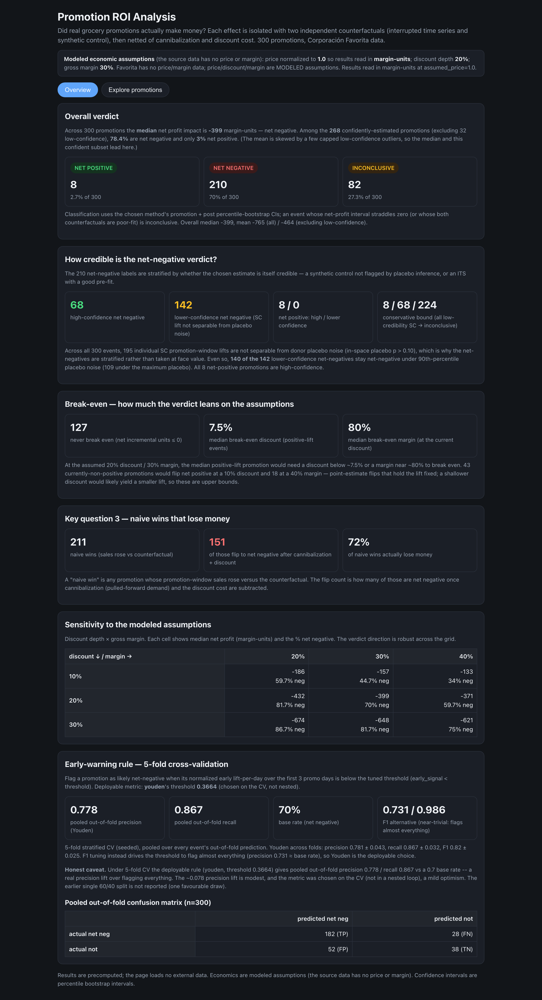
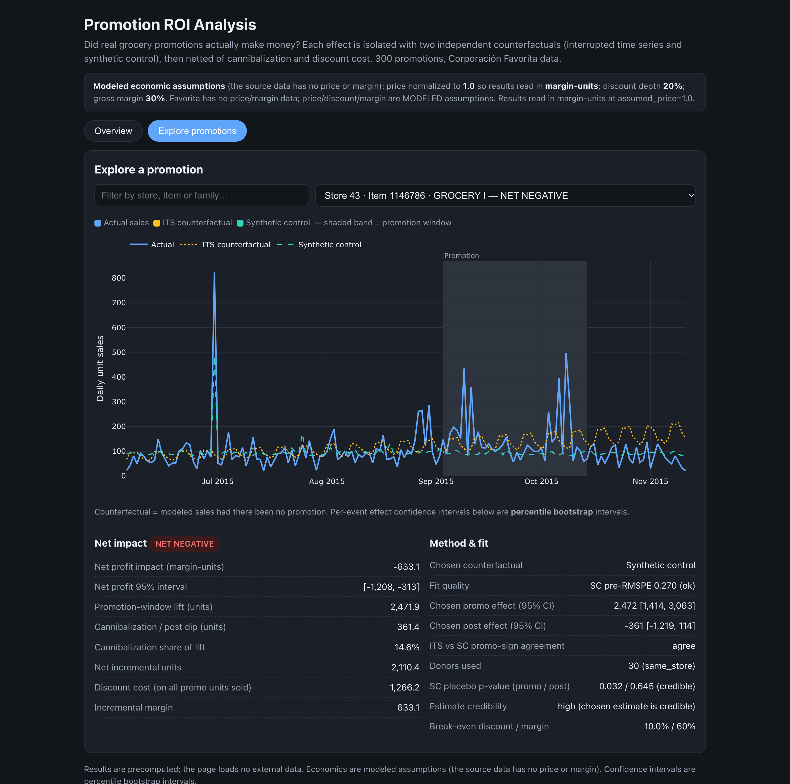

# Promotion ROI Analysis

Did real grocery promotions actually make money — or just move sales around? This project
measures the **true profit impact** of 300 real retail promotions, separating each promotion's
genuine causal effect from the trend, seasonality and noise that would have happened anyway, then
netting out pulled-forward demand (cannibalization) and the discount cost.

Rather than a naive before/after comparison, every promotion is evaluated against **two
independent counterfactuals** — an interrupted time series model and a synthetic control — and the
results are published as a precomputed, interactive dashboard.

**Live dashboard:** https://sneha0504.github.io/Promotion_ROI_Analysis/





## Key findings

The analysis covers **300 promotions across 34 stores and 81 items** (7 product families),
running from 2014 to 2017.

- **The two counterfactuals agree on the lift.** On the 203 promotions both models fit well, the
  ITS and synthetic-control estimates of the promotion-window lift correlate at **0.867** — strong
  corroboration from two independent methods. Individually, though, most lifts are hard to pin down:
  **195 of 300** synthetic-control promotion-window lifts are not separable from donor placebo
  noise (in-space placebo inference, p > 0.10), which is why the verdict below is credibility-tiered
  rather than taken at face value.
- **Under the assumed economics, most promotions lose money — but how many is credibility-tiered.**
  Of the 300 promotions the primary split is **8 net positive (2.7%) / 210 net negative (70.0%) /
  82 inconclusive (27.3%)**. Of the 210 net-negative, **68 rest on placebo-credible estimates** and
  **142 on lower-credibility lifts**; **140 of those 142 still read net-negative under
  placebo-scale (90th-percentile) optimistic noise** (109 even under the maximum placebo). The
  conservative lower bound (downgrading every low-credibility SC lift to inconclusive) is **8 / 68 /
  224**. Median net profit impact is **−399 margin-units** (mean −765; the median leads as the mean
  is pulled by a few capped outliers). The 8 net-positive are **only 8 events, all high-confidence**.
- **"Lose money" is conditional on the 20% discount / 30% margin assumptions.** By break-even
  analysis the median positive-lift promotion would need a discount **below ~7.5%**, or a margin
  **near ~80%**, to break even at the current assumptions — i.e. the typical promotion is
  underwater because the discount is spread over units that would have sold anyway, not only the
  incremental ones. (127 promotions never break even at any discount, having created no net
  incremental volume.)
- **Many "wins" are actually losses.** **211** promotions look like wins on a naive before/after
  view (sales rose versus the counterfactual), but **151 of them (72%) flip to net negative** once
  cannibalization and the discount cost are subtracted.
- **The direction is robust to the assumptions.** Across the full discount-depth × gross-margin
  sensitivity grid, the net-negative share ranges **~34%–87%** and dominates every cell. Even the
  most generous assumptions (10% discount, 40% margin) leave more promotions net negative than net
  positive. The verdict is driven far more by discount depth than by margin.
- **Cannibalization is real but modest.** The **median cannibalization share is 8.4%** of the
  promotion-window lift (where defined; undefined for 89 events with non-positive lift) — most of
  the damage comes from the discount cost on units that would have sold anyway, not from
  pulled-forward demand.
- **A simple early-warning rule beats the base rate, modestly.** Using only the first 3 days of a
  promotion, a threshold tuned under **5-fold stratified cross-validation** (pooled out-of-fold,
  n = 300) flags likely net-negative promotions with **precision 0.778 and recall 0.867** against a
  **0.70 base rate** — a real but modest lift (the metric was chosen on the CV, not in a nested
  loop). Tuning on F1 instead drives the threshold to flag almost everything (precision 0.73 ≈ base
  rate), so Youden's J is the deployable choice.

### Economic assumptions (clearly labeled)

The Favorita dataset contains **no price and no margin** data, so the discount cost and profit
figures are computed from explicit, configurable assumptions:

- **Price is normalized to 1.0**, so all profit figures are reported in **margin-units**.
- **Discount depth: 20%** of price during the promotion.
- **Gross margin: 30%** on a unit at full price.

These are modeled assumptions, not measured values — which is why the "loses money" conclusion is
stated conditionally (see the break-even finding) and the dashboard includes a sensitivity grid
showing the direction holds across a range of discount and margin values.

## How it works

For each promotion, a long pre-period is used to model what sales *would* have been without the
promotion (the counterfactual), using two methods:

1. **Interrupted time series** — a regression on the pre-period (trend, day-of-week, holidays)
   projected forward.
2. **Synthetic control** — a weighted blend of comparable non-promoted item-stores that tracks the
   target's pre-period behavior.

The promotion effect is the gap between actual sales and the counterfactual, measured over both
the promotion window and the following weeks (to capture cannibalization). These are combined into
a net profit impact and each promotion is classified net positive, net negative or inconclusive.

Full details are in [`docs/methodology.md`](docs/methodology.md).

## Running it locally

Requires Python 3.12.

```bash
# 1. Create a virtual environment and install dependencies
python -m venv .venv
source .venv/bin/activate
pip install -r requirements.txt
# or: make setup

# 2. Run the full pipeline (data selection -> models -> impact -> dashboard)
make all

# 3. Run the test suite
make test

# 4. Rebuild just the dashboard
make dashboard
```

The pipeline reads the raw Favorita CSVs from `data/raw/`. **That data is not included in this
repository** (it is large and redistribution is governed by the Kaggle competition rules), so it
must be downloaded separately and extracted into `data/raw/` before running `make all`. The
committed result tables in `data/processed/` let you rebuild the dashboard (`make dashboard`)
without the raw data.

Individual stages are available as Makefile targets: `make select`, `make panel`, `make its`,
`make synth`, `make impact`, `make warning`, `make dashboard`.

## Data source

**Corporación Favorita Grocery Sales Forecasting** (Kaggle competition): real daily unit sales
across Ecuadorian grocery stores and product families, with a per-item-per-day `onpromotion` flag,
plus store metadata and a holidays/events calendar.

- https://www.kaggle.com/competitions/favorita-grocery-sales-forecasting/data

The dataset is provided under the Kaggle competition rules; it is used here for analysis and is not
redistributed in this repository.

## Tools and libraries

- **Python** (pandas, NumPy, SciPy, statsmodels) for the modeling pipeline.
- **DuckDB** for SQL-based extraction and aggregation over the ~125M-row source data.
- **Plotly** for the interactive charts (vendored locally; the dashboard is fully self-contained).
- **pytest** for the test suite and **ruff** for linting.
- **Git** and **GitHub Pages** for version control and publishing the dashboard.
